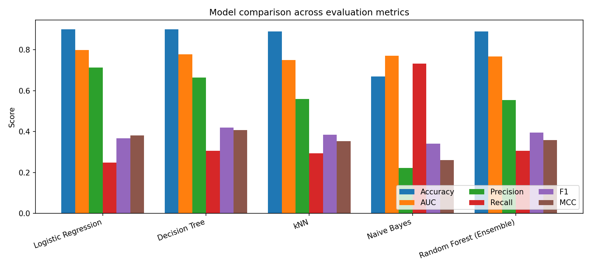
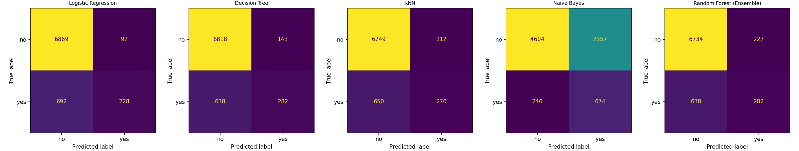

# Bank Marketing: Predicting Term Deposit Subscription

## 1. Problem Statement
Banks run telemarketing campaigns to get customers to open a term deposit, but most of the people they call say no. In this dataset only about 11% of the clients subscribed, so a lot of calls are spent on people who were never going to say yes.

In this assignment I try to predict whether a client will subscribe to a term deposit (`y` = yes/no) using client details (age, job, marital status, education), campaign information and the economic situation at the time of the call (employment variation rate, consumer confidence index and so on). This is a binary classification problem.

I removed the `duration` column (length of the last call) because it is only known after the call ends, so it would not be available when deciding who to call, and keeping it would make the models look better than they really are. Since the data is imbalanced, I do not rely on accuracy alone. I compare AUC, precision, recall, F1 and MCC across five models: Logistic Regression, Decision Tree, kNN, Naive Bayes and Random Forest.

## 2. Dataset Description

- **Source:** [Bank Marketing Campaigns Dataset (Kaggle)](https://www.kaggle.com/datasets/volodymyrgavrysh/bank-marketing-campaigns-dataset), based on the UCI Bank Marketing data
- **Why I chose it:** It is a real business problem, it is large (over 41,000 rows), it has a good mix of numeric and categorical features, it has hidden missing values, and the classes are heavily imbalanced, which makes the choice of evaluation metric matter.
- **Instances:** 41,188 (39,404 after removing duplicates)
- **Features:** 19 after dropping `duration` (9 numeric, 10 categorical)
- **Target variable:** `y` (no = 0, yes = 1)

| Type | Features |
|---|---|
| Numeric | age, campaign, pdays, previous, emp.var.rate, cons.price.idx, cons.conf.idx, euribor3m, nr.employed |
| Categorical | job, marital, education, default, housing, loan, contact, month, day_of_week, poutcome |

Note: `pdays = 999` means the client was not contacted in a previous campaign, it does not mean 999 days.

### Class distribution

| Class | Count | Share |
|---|---|---|
| no | 36,548 | 88.7% |
| yes | 4,640 | 11.3% |

The data is strongly imbalanced. A model that always predicts "no" would already get about 88.7% accuracy, so accuracy alone is misleading here. Recall, F1 and MCC matter more. Plot: `results/class_distribution.png`.

### Missing values
Missing values are stored as the text `unknown`, so I converted them to real missing values first.

| Column | Missing count |
|---|---|
| default | 8,597 |
| education | 1,731 |
| housing | 990 |
| loan | 990 |
| job | 330 |
| marital | 80 |

### Preprocessing
- **Missing values:** median imputation for numeric columns, most frequent value for categorical columns
- **Duplicates:** 1,784 duplicate rows removed. Many of these appeared only after dropping `duration`, since rows that differed only in call length became identical.
- **Encoding:** one-hot encoding for categorical features, label encoding for the target
- **Scaling:** StandardScaler on numeric features (needed for Logistic Regression and kNN)
- **Split:** 80:20 train/test (31,523 train rows, 7,881 test rows), stratified to keep the class ratio, `random_state = 42`
- **No data leakage:** all preprocessing is inside a scikit-learn `Pipeline`, so it is fitted on the training data only

## 3. GitHub Repository
https://github.com/2026ct05145/2026ct05145-ml-assignment-2

## 4. Models and Results

Models used: Logistic Regression (max_iter=1000), Decision Tree (max_depth=8, min_samples_leaf=5), kNN (k=7), Gaussian Naive Bayes (default), Random Forest (200 trees). All five were trained and tested on the same split.

| ML Model Name            |   Accuracy |    AUC |   Precision |   Recall |     F1 |    MCC |
|:-------------------------|-----------:|-------:|------------:|---------:|-------:|-------:|
| Logistic Regression      |     0.9005 | 0.7991 |      0.7125 |   0.2478 | 0.3677 | 0.3817 |
| Decision Tree            |     0.9009 | 0.7787 |      0.6635 |   0.3065 | 0.4193 | 0.4066 |
| kNN                      |     0.8906 | 0.7492 |      0.5602 |   0.2935 | 0.3852 | 0.3525 |
| Naive Bayes              |     0.6697 | 0.7711 |      0.2224 |   0.7326 | 0.3412 | 0.2601 |
| Random Forest (Ensemble) |     0.8902 | 0.7672 |      0.5540 |   0.3065 | 0.3947 | 0.3578 |

Precision, recall and F1 are for the "yes" class.




### Observations

| ML Model Name | Observation |
|---|---|
| Logistic Regression | Best AUC (0.7991) and highest precision (0.7125), so when it predicts "yes" it is usually right. But it has the lowest recall (0.2478) and misses about three out of four real subscribers. Accuracy is high mostly because of the imbalance. |
| Decision Tree | Best overall balance: highest F1 (0.4193), highest MCC (0.4066) and highest accuracy (0.9009). Limiting the depth to 8 seems to have stopped it from overfitting. |
| kNN | Middle of the pack on recall but the lowest AUC (0.7492), so it ranks clients worse than the other models. It is also the slowest to run. |
| Naive Bayes | Very different behaviour: highest recall (0.7326) but very low precision (0.2224) and accuracy of only 0.6697. It flags many clients as "yes", catching most real subscribers but with a lot of false alarms. Its independence assumption is probably not true for this data, since the economic features are strongly correlated. |
| Random Forest (Ensemble) | Recall same as Decision Tree (0.3065) but lower precision, so F1 and MCC are slightly lower. I expected it to win, but I did not tune it, so it may improve with different settings. |
| **Overall** | **Decision Tree is the best model by MCC and F1.** Logistic Regression is best if ranking quality (AUC) or precision matters most, and Naive Bayes is the choice only if catching as many subscribers as possible matters more than wasted calls. |

All models have low recall on the minority class except Naive Bayes, and accuracy of about 90% is only a little above the 88.7% baseline of always predicting "no". Possible improvements are class weights, resampling (SMOTE) and threshold tuning.

## 6. Repository Structure
```
project-folder/
├── requirements.txt
├── README.md
├── test_data.csv
├── model/
│   ├── ML_Assignment_2.ipynb
│   └── (saved .joblib model files)
└── results/
    ├── metrics.csv
    ├── class_distribution.png
    ├── metrics_comparison.png
    └── confusion_matrices.png
```
